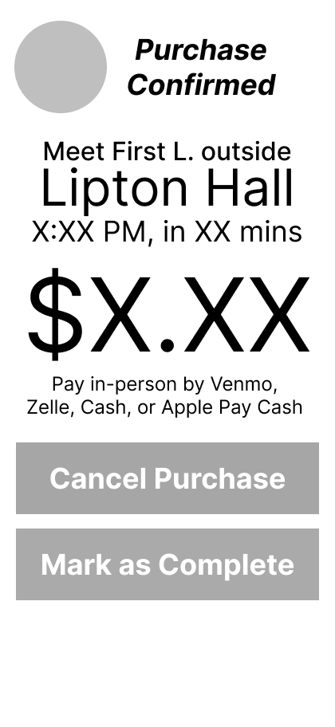
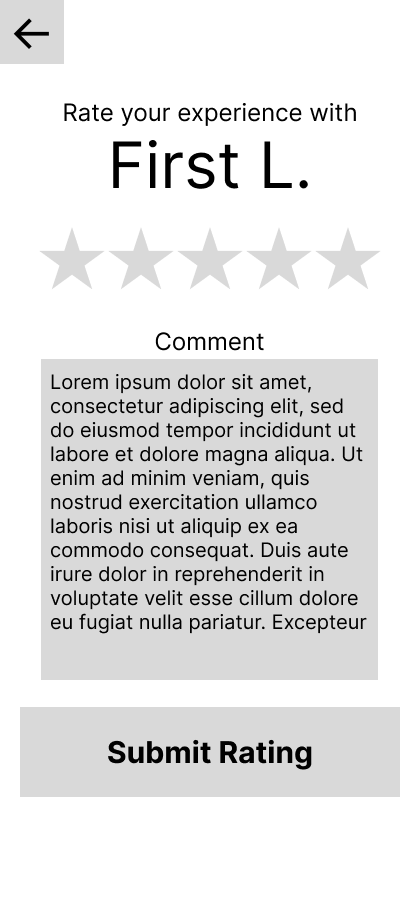

# User Experience Design

This repository contains instructions and files for two assignments that together comprise the user experience design phase of a web app.

Replace the contents of this file with the completed assignments, as described in:

- [app map & wireframe instructions](instructions-0a-app-map-wireframes.md).
- [prototype instructions](instructions-0b-prototyping.md)

## Wireframe

https://www.figma.com/design/RbnjNsG24SsouP9fG0YEEi/SwipeShare?node-id=0-1&t=EhtSRYF1WVgcjYj3-1

### Landing Page

### How It Works - FAQ

### Select User Type

### Purchase Flow

### Swipe Details

### Confirmation

### Rating

### Create a Listing

## App Map

